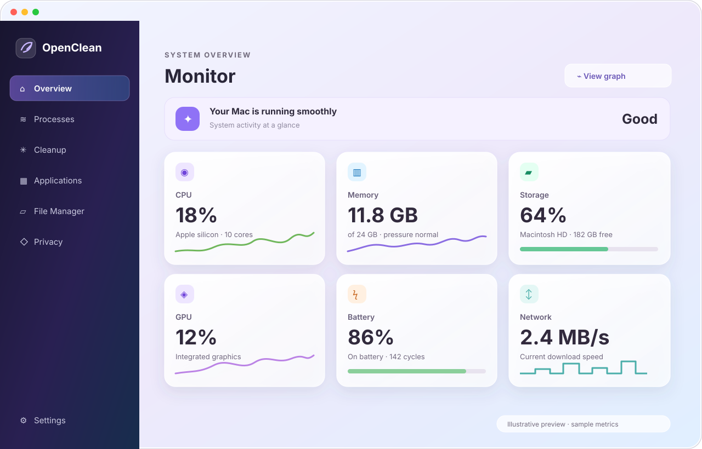
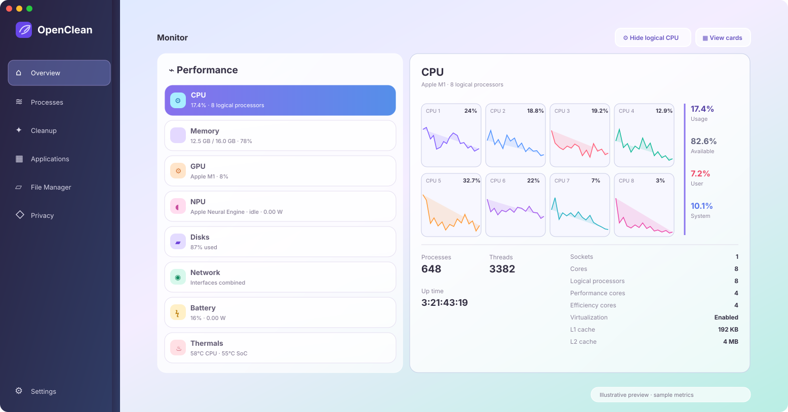

# OpenClean

OpenClean is a free macOS utility for understanding system activity and reviewing files that may be safe to remove. File scans and removal decisions stay on your Mac; OpenClean does not delete files automatically.



*Illustrative dashboard preview. Metrics shown are examples, not live data.*



*Illustrative Performance view inspired by the app. Metrics shown are examples, not live data.*

## Download

Requires an Apple silicon Mac. Download the latest app ZIP from [OpenClean releases](https://github.com/chadathan/openclean-releases/releases/latest). This release provides a ZIP and checksum only; it does not include a shell installer.

To download and verify the archive:

```bash
curl -fL https://github.com/chadathan/openclean-releases/releases/latest/download/OpenClean-mac-arm64.zip -o OpenClean-mac-arm64.zip
curl -fL https://github.com/chadathan/openclean-releases/releases/latest/download/SHA256SUMS -o SHA256SUMS
shasum -a 256 -c SHA256SUMS
```

After verification, extract the ZIP and move `OpenClean.app` to `/Applications` or `~/Applications`. This build uses a self-signed certificate and is not notarized with Apple, so macOS may warn or block the first launch. Continue only if you trust this build.

## Features

- System monitoring for CPU, memory, storage, battery, GPU, network, and thermals
- Cleanup scans with review-before-removal and Put Back records
- Application and developer-tool inventory with removal review
- File search, folder maps, and duplicate detection
- Process activity and low-storage alerts
- Permission Center for checking Full Disk Access

OpenClean has no account or sign-in requirement and does not collect usage analytics or telemetry.

## Build from source

Requires macOS, Node.js/npm, and Xcode Command Line Tools (Clang and Swift).

```bash
npm ci
npm start
```

To create a macOS app directory:

```bash
npm run package:mac
```

## License

No license is currently provided. Public visibility does not grant permission to reuse or redistribute the source code.
